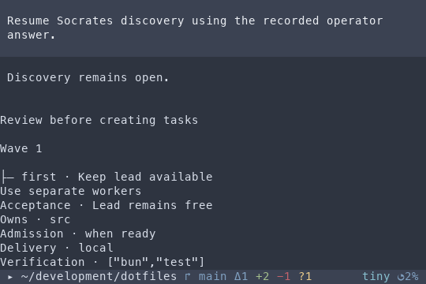
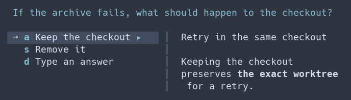
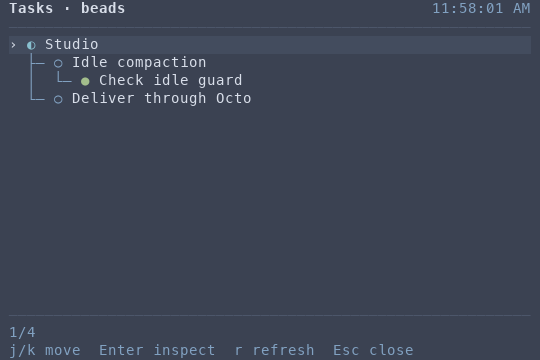
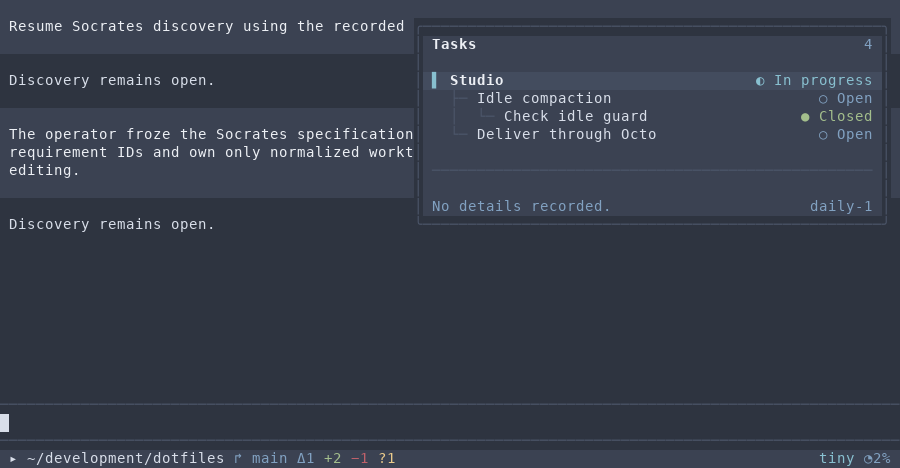
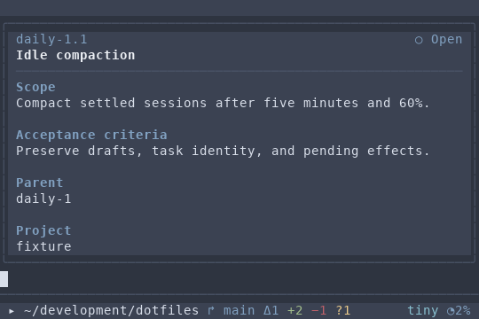
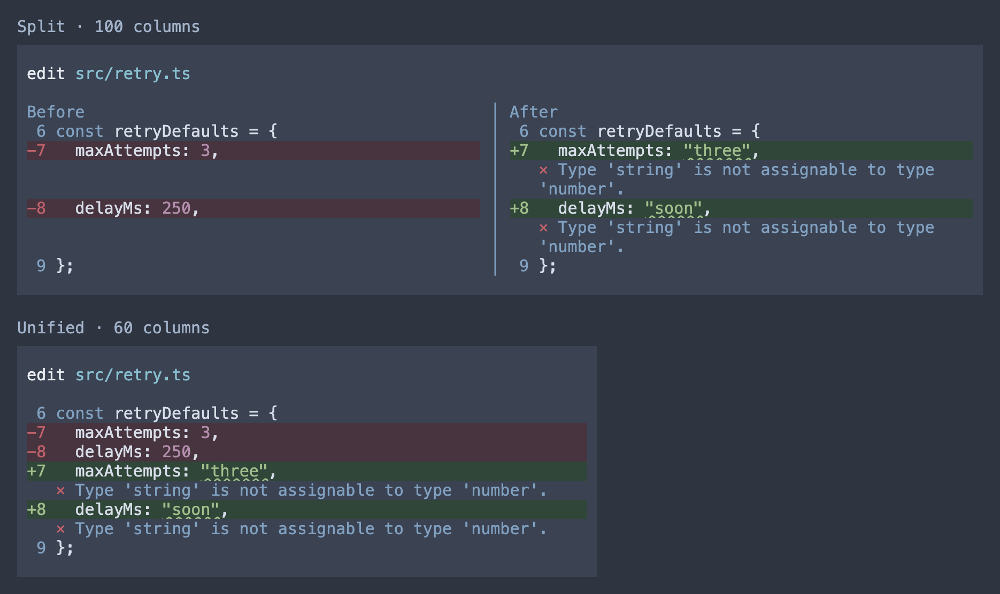

# Studio

Start Studio as your daily-driver Pi session in any directory, with no Beads task required. For task-bound work, Studio can also run an existing Beads task in an interactive Pi lead session, guide it in Zellij, and inspect the result from another terminal. Beads owns the task and the native worktree manager allocates its checkout. Both work and personal model profiles are supported.

Studio also provides the dotfiles theme, task browser and idle compaction. The [runtime guide](RUNTIME.md) covers independent discovery, approved background work, Pi-owned Octo delivery, and recovery.

## Package layout

`cli.ts`, `extension.ts`, `lead-extension.ts`, and `worker-extension.ts` are stable entry points. Internal code is grouped by capability when its owner and callers are clear:

| Location | Responsibility |
| --- | --- |
| `socrates/controls.ts` | Socrates commands and tools, pending-question presentation, answer persistence, revision checks, specification freeze and approval |
| `socrates/spec.ts` | Persisted specification, question and decision schemas and transitions |
| `socrates/guidance.ts`, `socrates/host.md` | Load the bundled Socrates skill and adapt it to the managed Pi host |
| `socrates/selector.ts` | Adapt persisted questions and evidence to the reusable selector; own typed-answer choice and cancellation |
| `socrates/evidence.ts`, `socrates/links.ts` | Validate question evidence and resolve its source links in the managed checkout |
| [`@lanej/pi-components`](vendor/pi-components/README.md) | Independent terminal components: choice rendering, Vim movement, transient hints, detail views and explicit selection |
| `tests/`, `acceptance/` | Workflow checks and independently runnable native acceptance fixtures |

The selector returns an item index or cancellation. Socrates owns the typed-answer option, pending question, answer persistence, accepted revisions and approvals. Keep question side-chat orchestration with its Socrates caller and reusable interaction widgets in the component package. Task browsing and plan review remain with their existing callers in `ui.ts`; add further capability directories when they have a clear owner rather than creating empty layers. Shared skill paths resolve relative to this package, including when it is installed from a managed worktree.

## Install

With [dotfiles](https://github.com/lanej/dotfiles/blob/master/docs/pi.md#install), select `workstation` or set `tools.studio = true`, then run `make install`. Use `make studio-install` from the dotfiles checkout for a Studio-only installation. Dotfiles resolves selected projects' minimum runtime requirements, provisions a shared Bun when needed, and delegates to this project's installer; existing source revisions, local work, and Pi settings are preserved. Set `tools.studio = false` to disable installation without uninstalling Studio.

For standalone installation, provide Bun 1.4.5 or newer on `PATH`. The `engines.bun` minimum in `package.json` is authoritative; an already compatible runtime is used as-is:

```sh
git clone https://github.com/lanej/studio.git ~/src/studio
cd ~/src/studio
bun install --frozen-lockfile --ignore-scripts
bun run install:local
```

Installation builds a versioned bundle under `~/.local/share/studio/releases`, exposes `~/.local/bin/studio`, and registers that bundle with Pi. It includes the pinned Pi host, extension sources, dependencies, and resources. Bun remains an environment dependency and is never copied into the release or embedded in an executable. Both launchers check its minimum before loading application code; a missing or older Bun fails with setup guidance. Providers, models, credentials, unrelated packages, and an existing theme choice are preserved. `PI_CODING_AGENT_DIR` selects an alternate Pi directory; `STUDIO_PREFIX` selects an alternate installation prefix. Reload or relaunch Pi to discover `/cd`, `/tasks`, `/studio-profile`, and `/studio-status`. Existing sessions keep running.

For development, `bun run configure` registers this source package without installing it. `bun run check:build` validates the CLI source graph without creating an executable with an embedded runtime. `scripts/studio` runs the CLI source, and `scripts/pi` starts the pinned native Pi host; both use Bun from `PATH`. Managed hosts and delegated children use Bun; Node/npm are not required by this package. Both launchers select the bundled Bun configuration and disable dotenv autoload before the runtime check and application entry, so checkout preloads cannot run ahead of Pi trust checks. Explicitly inherited environment variables remain available. Python is needed for installation/configuration helpers. The integration tools below are optional; installation does not provision them.

The project-owned updater adapter is `scripts/lifecycle.mjs`. Once the separate checkout is registered with the workstation's project updater, use `project-update pull studio`, `project-update build studio`, and `project-update restart studio`, or `project-update update studio` for the sequence. Native managed Pi hosts expose their loaded bundle and shared Bun executable identity, guarded conversation checkpoints, and exact transcript/branch restoration. The updater cancels an admitted model request once, retains recoverable input, and hands terminal-owned restoration to Zellij without replaying interrupted work. Legacy hosts, active native subprocesses, and sessions without a persisted conversation remain intact and report incomplete status 3. Build stages the selected checkout without pulling. Previous bundles remain available. See [activation contracts](ACTIVATION.md).

Dotfiles registers this checkout as `studio`; its updater and installer use the environment's shared Bun and read `package.json` for the minimum. The [dotfiles registry](https://github.com/lanej/dotfiles/blob/master/config/project-updates.toml) owns that registration. Project requirements can raise the shared minimum without changing Studio's bootstrap or installing a private runtime.

Export standalone source with `python3 scripts/export.py /path/to/empty-destination`. See [source provenance and integration ownership](EXTRACTION.md).

The theme comes from a bundled snapshot of the shared semantic adapter, with Nord selected by the current design-system preset. The terminal retains its canvas and opacity settings. The task tree opens as a right-side overlay with colored status glyphs. Enter opens task details with the state written out. Right focuses a task’s live managed Pi pane in the same Zellij session when the action is shown. Task selection and details omit keyboard instructions and policy boilerplate. The footer shows the current directory using [shortpath](https://github.com/lanej/dotfiles/blob/master/tools/shortpath/README.md) when it is on PATH. Colored glyphs mark the lead mode and reasoning level alongside the bead ID and model. The same row fits Git changes, the Octo-tracked PR, context usage, and estimated session cost as space allows. GPT model IDs show a provider glyph, version, and variant glyph for Sol, Luna, Terra, and Astra. Secondary fields collapse as the pane narrows, and other extensions retain their status lines. Startup hints, resource listings, zero-usage counters, and the permanent compaction-policy line are hidden. Bash tool cards highlight shell syntax in command lines. Code from Pi’s grep tool and supported `rg` and `sed` shell tool calls uses the active syntax theme. Pi’s output folding and truncation remain available. Actionable errors remain visible.

Run `studio config --example` to see a full JSON configuration example. Studio reads `${XDG_CONFIG_HOME:-~/.config}/studio/config.toml` first and falls back to `config.json` when TOML is absent. Set `STUDIO_CONFIG` to select an explicit TOML or JSON file. If you already use JSON and switch to TOML, carry your existing settings over to the TOML file; Studio reads one file. Without a default configuration file, Studio uses its built-in defaults; a missing explicitly selected file is an error. Configuration inspection and `studio skill` need no services or credentials.

## Start a daily-driver session

Run `studio` or `studio lead` from the directory where you want to work. Studio opens its bundled Pi host in the current terminal and loads the Studio extension. A bead, Zellij, and the worktree manager are not required. Pi retains its normal session persistence, project trust checks, provider authentication, and model selection. Use `/studio-profile work` or `/studio-profile personal` inside the session to select a configured lead profile.

Use `studio lead` to pass native Pi options or an initial prompt. Place Pi options after `--` so they reach Pi, including its own help:

```sh
studio
studio lead -- --continue
studio lead -- --resume
studio lead -- "Help me understand this project"
studio lead -- --help
```

`studio resume BEAD_ID` resumes a managed Beads lead; `studio lead -- --resume` opens Pi's session picker for ordinary conversations. Daily-driver sessions use the current checkout. Starting a bead with `studio start BEAD_ID --profile work` retains the managed checkout workflow below.

## Discovery and approved work

The lead stays available for research and conversation. Use `/socrates` to start discovery, `/socrates new TITLE` for another topic, and `/discoveries` to list saved discoveries for this project. Resume one with `/socrates UUID`. Discovery, questions, recorded answers, specification versions, and proposed breakdowns are private Studio state; they require no Beads service. Pi retains the conversation separately. `/spec-freeze` reviews the specification; `/spec-reopen` preserves the prior version before reopening it.

At the end of Socrates, review the proposed work breakdown with `/plan`. For an explicit work request without Socrates, use `/plan-draft DESCRIPTION`. Neither creates tasks. `/plan-approve` shows the exact project, profile, task scopes, dependencies, hold intent, delivery obligations, and verification commands before creating the approved Beads graph. Approval also authorizes eligible implementation in separate workers. The lead stays free and can close while work continues.

Unattended execution is opt-in per configured project. Beads owns readiness: held tasks use its deferred status, and blocked tasks wait for prerequisites. Studio atomically claims eligible work, including existing ready tasks in enrolled projects, with no conversation-provenance filter. Each task needs bounded scope and acceptance criteria. An agreed verification command runs in isolation when provided; otherwise the independent reviewer must establish the criteria from the result. Missing authority or unresolved criteria park the assignment with retained evidence.

Configure `[runtime]` and `[[runtime.projects]]` as shown in [config.example.toml](config.example.toml), enable the native worktree integration, and configure the selected profile's lead, worker, and reviewer models through Pi. The pinned Beads HTTP service provides guarded task mutations and atomic claims; an explicitly configured native `bd` workspace supplies heartbeats and must match the HTTP project's identity and database. Approval preflights these authorities and verification isolation before creating tasks. An enabled runtime still requires project enrollment through an approved handoff.

```sh
studio runtime start
studio runtime status
studio runtime stop
studio runtime retry ATTEMPT_UUID
```

`start` requests a detached supervisor; `status` reports confirmed ownership, retained attempts, sessions, and effective merge policy. `stop` stops admission while existing task hosts continue. A process restart reconciles the same claims, allocations, and launch receipts. Unknown launch outcomes keep their writer fences; `retry` refuses a possibly live writer. Inspect `runtime.log` and the attempt's native host/session files under `${STUDIO_STATE_DIR:-~/.local/state/studio}` before resolving uncertain work. No automatic worktree removal discards these receipts.

PR tasks use Octo when explicitly enabled. Automatic merging defaults off for each project. The lead's `studio_project_merge_policy` tool can inspect, enable, disable, or restore that project's default, with an audit reason. Both directions are supported. Workers cannot change policy. Independent exact-head review, assessed feedback, passing current-head checks, and Octo's current-base merge gate remain required. With merging disabled, delivery remains pending while unrelated work continues. Local-only tasks integrate into a retained project integration ref before guarded Beads completion; dependent tasks receive that accepted result. PR-required tasks keep dependents blocked until confirmed merge and acceptance.



## Working directory

Use `/cd /path/to/project` to change directories while continuing the current conversation. Relative paths, `~`, and paths containing spaces are supported; `/cd` alone opens your home directory. Conversation history, compaction summaries, the session tree and selected branch carry over, along with the model and thinking level. An explicitly selected Studio profile is revalidated for the destination before delegation is re-enabled. Pi rebuilds its tools, project instructions, settings and resources for the destination, including its normal project trust checks. A directory-change message records the new location in the conversation. Pi saves the continuation under the destination with a link to the original session; the original file remains intact. Switching requires settled conversation and delegated work; managed Beads sessions stay in their assigned checkout. `/cd` is unavailable with `--no-session`, so switching never saves a deliberately private conversation.

## Optional integrations

Zellij, worktree manager, Octo, and Beads are optional. With no Studio configuration, `studio` starts a daily-driver session and the extension supplies directory switching, idle compaction, search rendering, and archive browsing; the CLI can also inspect configuration and report integration status. Installation does not start or require these services.

Set `integrations.zellij.enabled`, `integrations.worktrees.enabled`, or `integrations.octo.enabled` to opt in. Each accepts an `executable` name or absolute path. These integrations default to disabled and become available only when the configured executable is present. Configure Beads separately with `beadsService` or a read-only `beads` source. A configured service must be reachable to perform its operations. Missing or disabled integrations fail only the commands that need them, before task claims or checkout allocation.

| Capability | Integrations needed |
| --- | --- |
| Task inspection | Configured Beads source |
| Managed launch, focus, resume | Beads service, Zellij, worktree manager; launch/focus also need a live Zellij session |
| Explorer/Reviewer delegation | Explicit delegation/profile configuration and worktree manager |
| Unattended workers | Enabled runtime, enrolled project, matching Beads HTTP/native CLI, worktree manager, role models, verification isolation |
| Publish, PR feedback, merge | Bound task/Beads workflow and enabled Octo; runtime PR tasks use an independent controller |
| Finalize managed checkout | Bound task/Beads workflow, Octo, worktree manager |

`studio doctor` and `/studio-status` report enabled, present, and available states. Doctor also checks the package resources needed by the CLI and native host. Doctor succeeds with no optional integrations configured; enabled integrations that are missing or configured Beads sources that fail verification make it fail. The full configuration example enables the managed workflow integrations; remove or disable the ones you do not use.

## Idle compaction

Compaction requires five settled idle minutes **and** at least 60% context-window usage. Configure `idleCompaction.idleMs` and `idleCompaction.minimumContextPercent`; set `enabled` to `false` to disable this extension's policy. Pi's normal near-limit compaction remains unchanged.

The timer resets on terminal activity, input, tool execution, and blocking dialogs. Unknown context usage, active execution, pending input, editor drafts, and dialogs prevent compaction. Attempt markers are native session entries outside model context, scoped to the active branch. One new stretch of conversation history gets one idle attempt; failures remain visible and can be retried manually with `/compact`. Native/manual compaction also satisfies the current history. Reload, tree navigation, and session replacement discard old timers.

Managed Explorer and Reviewer children suspend idle compaction while their work remains active or uncertain. If a third-party tool with a subagent/delegation name executes, idle compaction is conservatively suspended for that runtime because that tool supplies no verified active-child count. Tree navigation and manual/native compaction preserve this guard; session startup clears it. Reload after independently confirming its work is settled. This does not establish compatibility with arbitrary background-agent extensions.

## Task inspection and profiles

Set `beadsService.url` to the configured [Beads service](https://github.com/lanej/dotfiles/blob/master/docs/beads.md) and `beadsService.projectId` to the actual `project_id` from its `GET /v0/beads/context`. Replace the example UUID. If the service requires a bearer token, set `beadsService.tokenFile` to its absolute path. Each read and write carries the project identity. Existing configurations with only `beads.workspace`, `database` and `branch` retain native read-only browsing.

`/tasks` browses the native containment tree. `studio tasks ID --json` reads the current bead directly from the service and includes the most recent execution attempt recorded on this host. It works after the Pi session exits. A local attempt records the admitted brief, checkout, native session and verification evidence. Reading another host's task requires only its service connection.

`/studio-profile work` and `/studio-profile personal` select the configured lead model in Pi. Set each profile's worker provider, model and reasoning level before starting a task. Work uses its configured HTTPS Bedrock Mantle endpoint. Personal uses Pi’s `openai-codex` provider. Authenticate with the selected provider through Pi. Both examples use Sol 6.1, at high reasoning for the lead, medium for Worker and Reviewer, and low for Explorer. Choose any available model for each role.

Run `studio config --pi-models --region YOUR_AWS_REGION` to generate the work provider. The region defaults to `AWS_REGION`, then `AWS_DEFAULT_REGION`; there is no fixed region. Studio matches Pi's bundled and cached Bedrock models with the [models.dev API declarations](https://models.dev/experimental/v2.0/api.json), the source used by [Pi's catalog generator](https://github.com/earendil-works/pi/blob/main/packages/ai/catalog/sources/models-dev.ts). Each Mantle model gets its declared Responses, Chat Completions or Messages transport and endpoint path through [Pi's per-model configuration](https://github.com/earendil-works/pi/blob/v1.4.0/packages/coding-agent/docs/models.md). IDs, limits, pricing tiers and input/reasoning metadata come from Pi; transport compatibility uses the selected API's declarations. This covers catalog models across vendors without a model allowlist. The command downloads the API declarations; pass a saved catalog as `--pi-models /path/to/api.json` for offline generation. It does not refresh Pi's catalog.

Merge the emitted `providers.bedrock-mantle` entry into `${PI_CODING_AGENT_DIR:-~/.pi/agent}/models.json`, preserving other providers and any intentional overrides in that entry. It references the existing `AWS_BEARER_TOKEN_BEDROCK` environment variable and prints no credential values. It changes no settings. Select `/model bedrock-mantle/MODEL_ID`, or configure the work roles from `studio config --example` and select `/studio-profile work`. Native `amazon-bedrock` models and their inference-profile IDs remain available. Generated metadata does not establish model availability in the chosen region or compatibility with its effective [data-retention policy](https://docs.aws.amazon.com/bedrock/latest/userguide/data-retention.html); provider setup changes no account policy.

## Run a bead locally

From the repository in a running Zellij session, use the full ID of a ready, unassigned bead. Supply the agreed verification command as separate arguments after `--`. For example, if the bead's acceptance criteria are covered by `make test`:

```sh
studio start "$BEAD_ID" --profile work -- make test
studio tasks "$BEAD_ID" --json
```

The first command validates the selected lead profile, claims the current brief in Beads, allocates a dedicated worktree and opens the interactive Pi lead through Zellij’s native socket. It leaves focus in the caller pane. Choose a different tab with `--tab-id`. Repeating the same command focuses the registered worker so you can type guidance into its existing session. If launch or ownership is uncertain, inspect its recorded attempt before recovering the checkout.

The lead starts in read-only planning mode. Use `/socrates` to work through scope and evidence using the shared Socrates procedure. The lead saves consequential questions before opening a native Pi dialog. Escape leaves a question open, and `/socrates` resumes it. A complete brief can go straight to specification review. Use `/spec-freeze` to review and freeze the specification before asking Pi for its implementation plan. Use `/plan` to inspect the task graph and `/plan-approve` to review its dependency waves and authorize implementation. The approval creates child beads and their containment and blocker edges in one revision-guarded batch. The graph and review patterns are adapted from [Smart Plan](https://github.com/jnardiello/pi-smart-plan/tree/3e51e33acd63a7743391e21598042438746aafa0). Use `/plan-refresh` to read a changed brief and reopen the specification. Use `/diff` to review working-tree changes inside Pi.

Use `j` and `k` to move through choices, `;` and a letter hint to jump, `l` to inspect details, and `h` to return. The Markdown explanation beside the list follows keyboard focus. Evidence can include a source file and line, a URL, or an observation such as command output. Source and URL references use OSC 8. A `▸` beside a choice indicates a longer explanation or evidence links. Press `Enter` to select the focused choice. Escape backs out of hints or details before it dismisses the question.



Run `studio resume "$BEAD_ID"` in Zellij after Pi exits. Studio revalidates the Beads claim and opens the original transcript in the same managed checkout.

Pi can call `task_submit_result`. An operator can also type `/task-submit SUMMARY` in the same pane. Studio runs the agreed command in that checkout and checks that its Git state held throughout verification. A lead saves passing evidence and retains the open Beads task while waiting for delivery. The legacy direct `start --worker` flow can record local verification and close the bead. Beads checks the accepted revision, owner and status together. Evidence includes the command, exit code, Git state and the last 8 KiB of verification output.

Supply a verifier only when it covers the full accepted criteria. Omit it when a human must decide. A failing check keeps the bead open and can be retried in the same session. Changed task scope or checkout contents require review. For a service that permits direct database or text writes outside the revisioned Beads interfaces, set `beadsService.reviewOnly` to `true`. Studio still runs the agreed command and retains the result for review.

`studio doctor` checks the configured task source. New local runs also require Pi, the native `worktree` manager, Zellij and a configured worker profile. Fleet dispatch and replacement after an uncertain launch are separate workflows.

## Deliver through Octo

The local Octo service and CLI must support Pi tracking. Push the reviewed branch head to GitHub, verify its clean commit in the lead, then publish its reviewed PR draft.

```sh
studio publish "$BEAD_ID" --title "$TITLE" --body-file "$BODY" --base main
```

Reissue the same request to reconcile its stored publication receipt. Open `/octo-inbox` in the lead to see the PR’s messages. Studio saves each applicable message before acknowledging receipt. Verification and Octo receipts appear inline in the transcript without adding model context. Use Pi’s expand key (Ctrl+O by default) to fold or unfold their details. GitHub PRs, issues, commits and code links carry distinct glyphs. After addressing current feedback, commit, push, and reverify any fixes on the same branch. Record the owner’s assessment and request an exact-head merge from a current Ready notice.

```sh
studio ready "$BEAD_ID" --head "$SHA"
studio merge "$BEAD_ID" --head "$SHA" --notice "$NOTICE_ID"
```

After Octo confirms the merge, exit the lead and settle its child beads. Run `studio archive "$BEAD_ID"` from a surviving checkout. The command retains the transcripts and a recovery manifest, confirms Beads closure, and asks the native manager to remove the eligible checkout. A retention decision leaves finalization pending. Repeating the command resumes it. The original branch and native transcripts are preserved.

## Checks

```sh
bun run quality:tools
make check
bun run test:beads-native -- --bd /absolute/path/to/bd --dolt /absolute/path/to/dolt
```

The tools command explicitly installs the pinned quality dependencies from their Bun lockfile. `make check` runs the repository's complete strict TypeScript profile for this package: compiler checks, typed ESLint, Biome, Prettier, workflow tests and dependency audit, followed by loading the configured package and generated theme through the actual pinned Pi runtime without a provider request. All authored TypeScript sources, including tests, acceptance scripts, and the adapted vendored client, are covered without a baseline. Generated declarations are checked by the strict compiler and regeneration. Run `bun run typecheck` or `run lint` for focused checks; `run format -- FILE.ts` requires explicit package-relative paths.

CI exercises the declared Bun minimum on Linux and macOS, and the latest stable Bun on Linux. The standalone acceptance checks use the same environment runtime for the installed CLI and Pi host, reject missing or insufficient runtimes, and preserve the previous installation when validation fails. For an installation change, `bun run test:standalone --installation-only` runs export, runtime preflight, staged installation, rollback, and native host checks. The default command additionally reruns quality and unit checks from the exported source.

The package retains the canonical compiler and typed lint rules under `.typescript-quality/`. Declaration checking stays enabled. Bundler resolution matches Pi's native TypeScript loader and the CLI's Bun runtime. The Biome profile retains the previous recommended lint rules alongside the canonical correctness rules; only its stylistic `useLiteralKeys` rule is disabled because strict `noPropertyAccessFromIndexSignature` requires bracket access. Runtime modes, events, session/message kinds, navigation keys, profiles, roles, reasoning levels, task states and relationships use enums. External data is validated before enum-specific decisions; custom provider IDs, task states and relationship types remain representable.

The native Beads probe uses a disposable service to race claims, edit the accepted fields using native Beads tools and verify that a stale closing PATCH is refused. The [interactive acceptance fixture](acceptance/local-run.md) runs real Pi, Zellij, the worktree manager and Beads with a loopback model. It checks same-pane steering and refocus, tool-driven completion, failed verification, edited scope and independent inspection after Pi exits.

The capture shows the native worker and verified Beads result in an isolated Zellij session with the installed `dotfiles` theme, `tmux` layout, and `lane-status` bar. The trial used a deterministic loopback provider.


The separately invoked `uv run --script acceptance/terminal.py --output docs/assets` exercises tree navigation, task details, Escape recovery, directory switching, invalid-directory recovery, and draft entry through actual Pi PTYs with a controlled Beads boundary. It checks the native theme colors, filled status pills and absence of startup/helper text. The retained renders preserve terminal-cell colors and crop unused terminal rows; they do not establish live provider behavior.







## Delegation and archives

Set `"delegation": { "enabled": true }` in Studio configuration, then start a managed lead with its selected profile. In a standalone persistent session, use `/studio-profile work` or `/studio-profile personal` to select a lead. Pi offers `studio_delegate` for Explorer and Reviewer assignments. Each assignment inspects the current committed revision in a native manager-owned checkout. The child receives a fresh context with only snapshot inspection tools, and its result returns to the lead. Configure the provider and model catalog through Pi. Unload standalone subagent packages for managed sessions.

Studio loads the pinned tintinweb runner through a small adapter. The configuration command prepares that runner after the package install. Attempts, checkout receipts and child sessions are retained privately under `${XDG_STATE_HOME:-~/.local/state}/studio`. An uncertain attempt blocks further delegation and idle compaction for its lead session. Inspect its recorded manager owner and native session before recovery. Use the native manager to finish and prune eligible read-only checkouts after reviewing their retained state.

Run `/archives` to search and preview archived lead sessions alongside existing Session Snap archives. The default database is `~/.pi/agent/session-archive.db`. Set `archives.database` to an absolute alternate path when needed. The picker shows up to the latest 1,000 archived sessions and opens a local, bounded preview. It opens the database read-only and does not modify transcript history.

Verify real delegation with `bun run test:delegation-native` and an installed native worktree manager. The terminal acceptance script also exercises archive search and preview at 60 and 100 columns.

## Standalone acceptance

Run `bun run test:standalone` to export into an isolated directory, install frozen dependencies, run strict checks, load native Pi, build and install the CLI, verify repeatable registration and activation reporting, and test failed-build recovery with Node/npm blocked. Add `--with-integrations` to include worktree-backed native delegation when that tool is installed. The full managed Zellij/Beads flow remains an independently runnable acceptance check; a controlled provider does not establish live provider or Octo service behavior.

## Code intelligence

Language servers can execute project code; for example, [rust-analyzer runs build scripts and proc macros by default](https://rust-analyzer.github.io/book/security.html). Automatic edit diagnostics, explicit LSP queries, and semantic rename all require explicit project approval, in addition to Pi's native trust check. Recorded approvals in Pi's trust store are reused; its implicit trust for projects without Pi-specific resources is insufficient. An untrusted project keeps ordinary editing available without launching a language server. Record approval through Pi's normal trust flow, or run `/lsp-trust` and confirm language-server execution for this session. Session approval is cleared on reload, shutdown, or `/cd` replacement and does not change saved Pi trust. LSP configuration and model-issued tool calls cannot grant that approval.

LSP support is enabled by default and starts installed servers on demand only after project execution is approved: `gopls` for Go, `rust-analyzer` for Rust, and `typescript-language-server` for TypeScript and JavaScript. Servers need their normal project dependencies; TypeScript projects need an accessible TypeScript installation. Pi does not install servers. Set `"lsp": { "enabled": false }` in Studio configuration to disable this capability. `/studio-status` reports server state and failures; restart or reload Pi after correcting a failed server startup.

`studio_lsp` provides definitions, references, implementations, hover/types, document/workspace symbols, and diagnostics when the selected server supports them. File paths select the project; tool positions and returned locations use one-based lines and UTF-16 columns. Text search remains available for discovery, configuration, strings, and unsupported languages. Protocol initialization does not guarantee that project indexing has finished.

Successful Pi edits and writes show readable error/warning diagnostics directly below their result in the conversation, with severity glyphs and source locations. By default, each diagnostic on a visible resulting line appears as an inlay. Inlays sit beside the code when space permits and wrap underneath it otherwise. Diagnostics with a known source range also undercurl the affected code. Messages for other lines appear below the diff. Set `display.inline_diagnostics = false` to move every message below the diff, where identical messages of the same severity share an entry.

Studio’s `edit` tool requires a brief `reason` explaining why the change is needed. One reason covers all replacements in a call. Studio shows it beneath the file path in the conversation. Earlier edits still render without a reason.

Studio uses Tree-sitter to parse the file versions that Pi actually reads and writes. When a hunk is inside an off-screen function, method, or type that Studio recognizes, its declaration appears above the code. Studio loads a local grammar by filename, including for TypeScript/TSX, JavaScript/JSX, Go, Rust, Python, Ruby, Bash, C++, C#, Java, PHP, PowerShell, CSS, INI, and JSON. These parsers work with LSP disabled. Studio saves the labels and changed token ranges with the edit so older diffs still refer to the code that was edited. If syntax analysis is unavailable, an approved language server can still supply an enclosing declaration.

Edit diffs show additions or deletions alone in a single full-width column. When Tree-sitter identifies a single corresponding identifier or numeric literal on each changed line and the result fits, the surrounding code appears once, as in `retries: 2 → 4`. The old and new values use the removal and addition colors. A change inside a comment, or an edit without saved syntax ranges, uses the full comparison. More complex edits, or replacements with an inline diagnostic on the changed line, show the old code on the left and the new code on the right when both sides meet the configured minimum code width. Narrower panes show a unified diff. Each side wraps independently without shifting subsequent paired rows. To change the cutoff, copy the `[display]` section from [config.example.toml](config.example.toml) into your Studio `config.toml`, set `display.min_split_columns` to a positive integer, and reload Pi. The default is 40 when the file or setting is absent. Set `display.added_background` or `display.removed_background` to a quoted `#RRGGBB` color to tint changed cells in split view and changed rows in unified view. Omitted colors use the active theme’s tool background.

The collapsed diagnostics view shows up to two distinct messages; expanding the native tool output shows the remaining bounded results. Diagnostics that arrive later update the same edit result without taking focus or starting another assistant turn; no diagnostics command is needed. Late results are retained in hidden native session messages so the model and restored chat history receive them. Missing servers do not fail the edit. Pending results and diagnostics without a document version remain labeled; neither establishes a clean file. Shell edits are refreshed on subsequent LSP queries. Servers and document state belong to the active Pi runtime and project and are released on reload, shutdown, or a `/cd` session replacement. Read-only delegated snapshots do not load this extension.

`studio_lsp_rename` first returns unified diffs and a five-minute preview token, then applies that token after rechecking the original contents. Renames use Pi's normal write tools and permission hooks; managed Edd leads also require an approved implementation plan and current task revision. File resource operations, symbolic links, `.git` paths, edits outside the active directory, overlapping edits, more than 100 files, and diffs exceeding the preview limit are rejected. Application across files is not atomic: a blocked or failed write reports the applied paths and recovery token. Original/proposed file contents are retained in the native `studio:rename-recovery` session entry before writing; these survive restart only when the Pi session is persisted. Inspect them before recovering through normal editing tools.

Run `bun run test:lsp-native` with `typescript-language-server` on PATH to exercise native Pi edits, cross-file navigation, diagnostics, stale previews, blocked writes, rename, and compiler validation in a disposable project. This check uses a controlled assistant tool-call boundary without making a provider request. The ordinary package tests exercise protocol failures, cancellation, Unicode positions, and unsafe rename proposals with a controlled server.



Pi’s diff renderer at 100 and 60 columns, captured in a browser terminal with sample TypeScript diagnostics.
