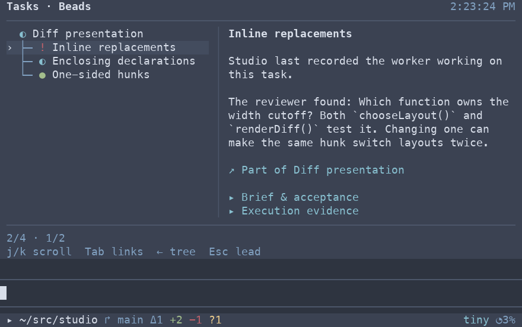

# Studio runtime

Studio separates the daily-driver lead, the approved work queue, and execution. The lead is a native Pi conversation that can research, edit and test code directly in the current checkout. Beads owns tasks and dependency readiness. Studio stores discovery and execution receipts outside disposable checkouts. The pinned Pi subagent runner executes workers and reviewers in native sessions; the native worktree manager owns their checkouts. Octo owns PR publication, feedback, and merge effects.

## Discovery and approval

Ordinary conversation requires no task. Bare `/socrates` starts a private discovery if none is selected, or continues the current one. `/socrates TITLE` always starts a new discovery with that title. `/discoveries` opens a picker of saved titles in the current project; Enter binds the highlighted record to the conversation, Escape preserves the current selection. The picker lists the newest records first and uses numbers and status to distinguish duplicate titles. If the project has no saved discoveries, Pi reports that instead of opening an empty picker. Selection preserves the saved specification and answers. Discovery IDs stay internal to persistence and conversation binding. Socrates saves questions before showing them and preserves recorded answers. The selection applies to the current native conversation branch and only for the matching canonical directory. Directory changes and session navigation preserve the original records.

Socrates opens the status panel and develops the specification and the proposed bead graph together. As a decision changes, update the affected requirements, proposed beads, dependency edges and checks. `/plan` previews this local graph during discovery. `/spec-freeze` reviews a current specification once each applicable property is satisfied with evidence and each inapplicable property has a rationale. A pending question, unincorporated answer, open decision or stale assessment keeps discovery open. `/spec-reopen` retains the frozen version before opening a new one. `/socrates-end` detaches the discovery from this conversation branch and returns to direct coding. Saved discoveries can be selected again. The specification records an evidenced PR decision before freeze. Each bead integrates locally or produces a PR according to that decision. A PR plan can reserve merging for a person or defer to the configured project policy. Project policy cannot override a plan’s manual-merge decision. An explicitly requested conversational plan or `/plan-draft DESCRIPTION` outside Socrates produces a local proposal.

`/plan-delivery TASK_KEY local|pull-request` revises only an unapproved proposal. Prospective Socrates work shows delivery as undecided until the policy resolves it. The handoff records the exact delivery outcome for each bead. Previously approved work retains its recorded delivery semantics. The task inspector separates approved intent from confirmed publication: a pending publication request is not a published PR. Missing or mismatched approval/attempt evidence remains unknown, and local results show their retained ref or integrated commit when available. The inspector reads unattended and interactive attempt stores independently and without creating or migrating them. Interactive verification heads do not establish a retained local result; that reference remains explicitly unavailable when it was not recorded.

For newly created children of a task-bound interactive lead, the accepted parent plan and child delivery record are checked before claim or checkout allocation. Local children use `studio start ... --worker`; PR children use the default lead verification and publication path. A mismatched launch mode is rejected rather than silently changing delivery. Older children without a recorded delivery retain existing launch behavior.

`/plan-approve` requires a frozen, property-assessed Socrates specification and a current proposed graph that covers its requirements. The review reads local project configuration. Interactive review also inspects the target Zellij tab. Confirmation enables Beads preflight and graph creation. Approval binds its digest, specification version, project, and selected profile. Concurrent edits invalidate the displayed approval. A pending or uncertain handoff prevents replacement drafts until the outcome is reconciled. Graph creation uses deterministic IDs and the native atomic batch; oversized graphs fail before mutation. Retrying an uncertain handoff reconciles those same tasks and edges rather than creating another graph.

Approval creates a controller-owned root and executable children in Beads and starts eligible implementation. Held children use Beads' `deferred` status. Dependencies and task state determine admission; existing eligible work in an enrolled project does not need to originate in the current lead. The root is an orchestration container, excluded from worker admission.

`/plan-approve interactive` records the approved plan and target Zellij server and tab before creating tasks. Interactive approval requires a compatible running supervisor, a tab with synchronized input off, local delivery, owned paths, and a verifier. The supervisor persists one launch token before sending the pane request. The pane registers its token, process incarnation, and terminal identity against the existing attempt before allocation or inference. A lost acknowledgement can settle through that registration. Unavailable or uncertain launches retain the attempt for inspection.

The Pi worker and controller share the registered process so checkout mutations use the existing owner fence. Reviewer sessions use the separate read-only runner. Pi accepts operator guidance during inference and displays queued messages. When the worker settles, the controller verifies, commits, independently reviews, and integrates the accepted result. Interactive verification or review failures park for inspection. The runtime keeps the same review and Beads completion gates for dependencies.

## Independent ownership

Enable `runtime.enabled`, configure each project explicitly, and enable the native worktree integration. The configured Beads HTTP project and native CLI workspace/database must agree. HTTP provides atomic claim-next and guarded mutations; the pinned native CLI provides heartbeats. Studio preflights the selected profile and verification isolation before approving a graph or admitting work. Missing integrations fail the affected capability; discovery remains usable. Changed project authority or profile settings suspend admission until a reviewed handoff reenrolls them. Retained incomplete attempts pin their authority and must be reconciled before enrollment settings change; project merge defaults remain adjustable independently.

`studio runtime start` requests a detached supervisor. `studio runtime status` reports the supervisor's PID/start identity, attempts, retained sessions, and effective project merge policy. `studio runtime stop` stops new admission while task hosts continue. Approved work survives closure of all lead terminals. Installation neither enables projects nor proves that an existing process loaded a new release.

The supervisor persists an actor/attempt before claiming work atomically. A lost response is reconciled by that actor, never by a second blind claim. Native checkout allocation and task-host launch retain intent and receipts. Manager mutations are serialized across task hosts; an abandoned allocation lease is reclaimed only after both its controller identity and remaining process group are confirmed gone. An exclusive supervisor fence and task launch tokens prevent competing writers. Unknown launches retain their ownership/path fences; a missing PID is insufficient evidence of settlement. Known dead hosts can recover the same attempt. `studio runtime retry UUID` requires positive reconciliation of the prior writer and verifier.

Concurrency defaults to two active inference hosts and can be configured from one to three with `runtime.concurrency`. Workers and reviewers share that limit. Overlapping owned paths serialize; an unspecified scope reserves the entire checkout. Delivery-pending work retains its scope but does not consume an inference slot. A project or task failure retains its evidence while independent work can continue. Runtime state lives under `STUDIO_STATE_DIR`, defaulting to `~/.local/state/studio`; native sessions and logs remain there with the attempt records.

## Worker and verifier boundaries

The controller snapshots the accepted task revision, profile, role models, reasoning, checkout identity, and source base. Missing model/authentication fails visibly without cross-profile fallback. Workers receive only bounded checkout read/write/edit and immutable snapshot inspection tools. Reviewers inspect the exact committed revision through read-only snapshot tools. Neither receives shell, nested delegation, policy changes, or GitHub authority.

Every admitted write rechecks the Beads revision/owner and local launch token. Checkout tools reject external paths, `.git`, symbolic links, and files outside accepted ownership. Controller Git operations bind to the registered worktree metadata and disable hooks, filters, external diffs, and merge drivers before processing worker-controlled data. Authorized network Git operations run from the trusted enrolled source.

When provided, an agreed verification command runs in a separately owned process with retained PID/start receipts. macOS uses `sandbox-exec`; Linux requires Bubblewrap and usable user namespaces. On macOS, verification preserves the selected Apple developer directory and read-only access to that toolchain. Verification can write its disposable source snapshot and private scratch space; the authoritative checkout and selected dependencies remain read-only. A sanitized Git view exposes source objects without the original repository configuration or authentication metadata. It cannot read controller state/authentication, write the host outside its scope, use host network/IPC, or signal the controller. Explicit `verificationReadPaths` can grant additional dependency reads but cannot expose controller state. A missing isolation backend blocks admission; there is no unrestricted fallback. The verifier records command, exit code, immutable Git state, and a bounded output tail. Failing or content-changing verification cannot establish acceptance. Without a command, no executable success is claimed; the independent reviewer must establish the accepted criteria with file evidence.

## Review, integration, and delivery

Once the controller verifies and commits the Worker's result, a fresh, read-only Reviewer inspects that exact revision. The Reviewer traces a representative case to the decision that governs it and identifies where a maintainer would change the rule. The Reviewer records both answers with `review_context` before Studio releases the Worker's report and any prior feedback. Studio checks that the verification receipt belongs to the tree under review. A clear change can pass on the first read.

When the code obscures a consequential decision, the Reviewer identifies the question, the source locations, and the maintenance consequence. The Worker receives the finding on the same assignment, makes a scoped correction, and the controller verifies and reviews the new revision. In `/tasks`, icons accompany task titles and the inspector shows the current owner’s reviewer finding. From the lead, `/tasks` opens a focused floating browser that refreshes every five seconds. By default Enter inspects the selected bead, Left returns to its tree row, and Esc closes the browser and restores the lead draft. The Workers section in the lead sidebar or dock stays passive. Choosing **Answer operator decision** opens the question and reply field above the lead editor. Your lead draft keeps its place while you answer. `/workers` opens the floating assignment browser. Use `/panes` to choose a workspace. To open one during a draft, assign a shortcut under `[keybindings.lead]` in Studio’s configuration. Briefs, acceptance criteria, identity and raw execution receipts expand on demand. The next review clears the previous finding. New scope or authority decisions park the task for assessment. Native transcripts retain the detailed execution history.

[60-column terminal view](docs/assets/task-readability-review-60.png) · [Empty project](docs/assets/task-empty.png) · Reproduce the terminal captures with `bun run test:terminal --task-review --output /tmp/studio-review`.

Local-only results integrate into a retained `refs/studio/projects/PROJECT_UUID` integration frontier and are reverified/reviewed before guarded Beads completion. Integration intent precedes ref mutation; completion follows confirmed reachability. If an integrated local result exposes a new finding that fits the task's owned paths, the Worker gets one repair attempt followed by fresh verification and review. Findings that need a change in scope or affect an already merged PR park for assessment. Successors receive accepted predecessor code. A restart between integration and task closure resumes the same result and cannot release dependencies prematurely. The interactive lead checkout is not changed.

A publishing bead starts from its PR’s fetched target branch. Studio applies the accepted changes from its approved local prerequisites in dependency order. It checks that upstream PRs have reached the target and leaves independent local work on the project frontier. If a prerequisite conflicts with the target or its acceptance receipt cannot establish what to publish, execution stops for reconciliation.

PR-required work needs the optional Octo integration and its configured project publication contract. Octo receives caller-written title/body and exact-head publication intent. The controller retains submission, ownership, inbox evidence, assessment, and merge receipts. Applicable feedback is inspected in full before assessment; delivery and acknowledgment are separate from resolution. Corrections use the same task and PR, followed by current-head verification and independent review.

Automatic merging defaults off per project. After handoff the lead-only `studio_project_merge_policy` tool can enable, disable, inspect, or clear that project's override with a recorded actor/reason/time. Overrides work in either direction and survive restart. The controller reevaluates policy before merge. Independent review, assessed feedback, passing current-head checks, current-base mergeability, and Octo's exact-head merge gate remain mandatory. For plans that follow project policy, disabling automatic merging leaves the PR pending. For plans that reserve merge for a person, the Ready notice displays `studio runtime approve-merge ATTEMPT --head SHA`. The command records consent against the owned PR, reviewed head and current notice. The controller checks those again before requesting the merge. A revised head or superseded notice requires fresh consent. A merge performed outside that flow requires reconciliation with the retained execution attempt.

Beads completion for required PR delivery waits for Octo-confirmed merge, fetched remote state, accepted result contents, and retained integration. Merge alone is insufficient task acceptance. No automatic checkout cleanup discards uncertain work. Existing operator-triggered archival still requires retained manifests/transcripts, settled effects, durable Git reachability, and native manager cleanup receipts.

## Acceptance evidence

The native fixtures use the pinned Pi host and runner, actual worktree manager, Beads HTTP/CLI, Dolt, and a deterministic local provider. They cover lead closure during work, separate worker/reviewer sessions, held/dependency admission, atomic readiness changes, deterministic graph reconciliation, and restart after integration before task closure. Separate native isolation fixtures exercise controller-state denial and Git callback suppression. Terminal acceptance drives bare and titled `/socrates`, project-scoped picker selection and Escape, and resume of a saved answer in a new native Pi conversation. It captures the picker and breakdown review at narrow and wide widths, and the open question at the wide width. Deterministic Octo fixtures exercise delivery policy and receipt handling without real GitHub mutations.

Controlled provider and service fixtures establish runtime wiring and recovery. They do not establish live provider or GitHub delivery acceptance. Source checks, hosted CI, installed release identity, and an already-running process are separate observations. Use the native scripts in `package.json` and inspect their retained results before enabling a live project.
