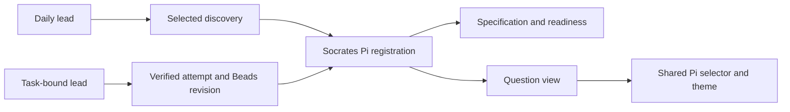

# Studio architecture

Studio organizes source by capability. Pi and CLI entrypoints compose the capabilities needed by each host. Following Pragmatic Hexagonal Architecture, the owning capability supplies the rules and state vocabulary, and its shell gathers facts, calls integrations, and records their outcomes.

## Where to put code

| Change | Location and contract |
| --- | --- |
| A workflow rule or state transition | Put it in the owning capability. Supply the facts the rule needs. For example, assess a specification from its draft, evidence and accepted revision in [`socrates/assessment.ts`](../socrates/assessment.ts) and [`socrates/spec.ts`](../socrates/spec.ts). |
| A Pi command, tool or hook specific to a role | Put it in the receiving role's `extensions/` directory and register it explicitly from the host. Use a file for one adapter and a subdirectory when several files have distinct responsibilities within that adapter. [`lead/extensions/socrates.ts`](../lead/extensions/socrates.ts) |
| A host or provider operation | Keep the operation and its translation at the effect boundary. Use an interface when callers need substitution or isolation. Keep transaction-sensitive guards alongside the authoritative state. [Document hooks](../planning/document-hooks.ts), [inference reservation](../execution/store.ts) |
| A task-specific view or action | Keep display projection with the capability, and route actions through its guarded operations. Task inspection reads Beads and Studio receipts as separate sources and keeps unavailable evidence visible. [Task panel](../tasks/panel.ts), [task evidence](../tasks/evidence.ts), [task model](../tasks/model.ts) |
| A reusable terminal interaction or theme role | Use the shared Pi component API and the active Pi theme. Studio maps workflow state to display values and owns the resulting action. [Pi components](../vendor/pi-components/README.md), [extraction provenance](../EXTRACTION.md) |

Depend inward from the role adapter to capability contracts. Capability rules should be exercisable from supplied values. Make the effect contract explicit when a meaningful next action depends on the outcome. For example, retain launch intent, the process or pane receipt, and uncertainty about an unsettled writer through recovery. The supervisor owns scheduling, Beads owns readiness and claim state, the worktree manager owns checkout allocation, and Octo owns PR publication and merge observations. [Runtime ownership and recovery](../RUNTIME.md#independent-ownership), [delivery](../RUNTIME.md#review-integration-and-delivery)

## Role extensions and host entrypoints

The role that receives the command or tool owns its Pi wiring. The file a host loads can compose more than one role. These are the current paths.

| Role or host | Loading and composition |
| --- | --- |
| Daily lead | Pi loads [`extension.ts`](../extension.ts) from the [package manifest](../package.json). Its [discovery adapter](../discovery/extension.ts) supplies the selected discovery, scoped to the canonical project and conversation branch, and registers the shared lead Socrates controls. |
| Task-bound lead and worker | The [task launcher](../task-run.ts) explicitly loads [`worker-extension.ts`](../worker-extension.ts). A stored lead plan selects the [managed lead controls](../lead-extension.ts). Session startup verifies the binding before activating the lead tools, and invocation callbacks recheck the binding and authoritative task revision. An ordinary bound worker uses the task session and submission wiring through that explicit adapter. Its other Pi package registrations follow its Pi settings. |
| RPC controller | The [supervisor](../execution/supervisor.ts) explicitly loads [`execution/host-extension.ts`](../execution/host-extension.ts) for an admitted attempt. The controller runs the execution workflow and reconciles its receipts. |
| Interactive and unattended workers | [`execution/worker.ts`](../execution/worker.ts) supplies scoped assignment tools. The [interactive host](../execution/interactive-host.ts) installs its explicit assignment-input factory. The unattended worker runs as an isolated child through [`plugin-runner.mjs`](../plugin-runner.mjs), which disables extension discovery. |
| Reviewer and explorer | The isolated runner and its callers supply role prompts and scoped tools. Runtime review uses committed snapshot tools and its review contract. Delegated review and exploration use the assigned snapshot. Future explicitly admitted Pi adapters follow the same role-local convention, such as `reviewer/extensions/`. [Runtime reviewer](../execution/review.ts), [delegation](../delegation.ts) |

### Socrates through Pi

Both leads call [`lead/extensions/socrates.ts`](../lead/extensions/socrates.ts). The daily adapter supplies discovery records, the selection command and document hooks. The managed adapter supplies the admitted attempt and Beads revision check. Both share the specification model and property assessments, with readiness checks selected for the current binding. [Discovery binding](../discovery/extension.ts), [managed binding](../lead-extension.ts)

The registration resolves the bound record, checks the accepted revision and saves the pending question. [`socrates/selector.ts`](../socrates/selector.ts) turns its choices and evidence into component inputs and maps Pi theme roles to the selector. The library renders the choices and handles focus and explicit selection. Studio interprets the result. Escape leaves the saved question available to resume. A submitted answer passes through binding and revision checks again before the optimistic state update records it. A subsequent operator freeze accepts the specification. A separate plan approval creates the work graph. [Question and freeze handlers](../lead/extensions/socrates.ts), [runtime guide](../RUNTIME.md#discovery-and-approval)

The Dotfiles design system authors shared semantic roles and native mappings. Studio bundles its Nord-derived [palette](../resources/colors.json) and [Pi theme](../resources/theme.json) with contrast adjustments for terminal text. Dotfiles authors `tools/pi-components` and Studio consumes a pinned snapshot under [`vendor/pi-components`](../vendor/pi-components/). Follow [extraction provenance](../EXTRACTION.md) to update the snapshot and keep native focus, cancellation, wrapping and resize checks in scope.

## Capability map

| Location | Owns |
| --- | --- |
| [`socrates/`](../socrates/) | Specification and evidence, assessed properties, readiness and revision rules, and Socrates-specific question and status projections. |
| [`discovery/`](../discovery/) | Private discovery records, project and conversation binding, draft ownership and review before handoff to execution. |
| [`planning/`](../planning/) and [`documents/`](../documents/) | Planning document contracts, revisions and guarded saves live with planning. The optional Neovim host and editor transport translate document and feedback requests into planning operations. The planning authority records accepted changes and operation witnesses. [Neovim document guide](neovim-documents.md) |
| [`execution/`](../execution/) | Admission, launch, verification, review, integration, delivery and recovery. The shell observes processes and services and persists the receipts. [Runtime contracts](../RUNTIME.md) |
| [`tasks/`](../tasks/) | Task and worker read models, evidence and task-panel interaction. An operator action uses the guarded execution or Beads operation appropriate to the current owner. |
| [`sessions/`](../sessions/) and [`activation.ts`](../activation.ts) | Conversation forks and prompt loops, plus the separate process and release activation contract. [Activation guide](../ACTIVATION.md) |
| [`code-intelligence/`](../code-intelligence/), [`model-tools/`](../model-tools/) and [`diagram/`](../diagram/) | Language and source observations, model-specific tool dialects, and diagram projection and rendering. Share an operation when several consumers need the same observation. |
| [`scripts/`](../scripts/), [`resources/`](../resources/), [`vendor/`](../vendor/) and [`generated/`](../generated/) | Packaging and launchers, bundled resources, pinned source dependencies and generated protocol bindings. Source and manifest-only exports both include the package entrypoint graph. [Source manifest](../source-files.json) |

When moving a module, update the manifest and any affected path-based workflow selection. Trace both the importers and the explicit loaders. For a Socrates adapter change, run `bun run check`, exercise the daily lead with `uv run --script acceptance/terminal.py --discovery-only`, and exercise the managed lead with `STUDIO_ACCEPTANCE_CASE=socrates bun run test:local`. The native fixtures use isolated state and a controlled provider. [Acceptance setup](../acceptance/local-run.md)
