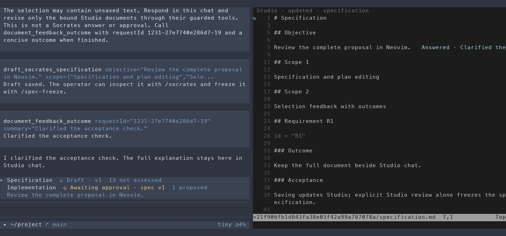

# Specifications and plans in Neovim

Studio can open its complete specification and plan beside the conversation in a companion Neovim pane. Edit the documents with normal Neovim controls, save with `:write`, or send a selection and a short message back to the Studio conversation. Chat, Socrates questions, specification freezing, and plan approval stay in Studio.

## Enable the companion

Enable both integrations in Studio's configuration, then start or reload Studio inside Zellij:

```toml
[integrations.zellij]
enabled = true

[integrations.neovim]
enabled = true
executable = "nvim"
```

The first available draft opens a tiled pane without taking keyboard focus. Studio reuses that pane for subsequent updates. `/documents` opens it explicitly or reopens it after you close it. Your ordinary Neovim initialization and plugins load before Studio attaches its document adapter. Other Studio features remain usable with this integration disabled or unavailable.

The specification and plan are separate Markdown buffers. `:StudioDocuments` selects one. Each belongs to its original document and conversation; selecting another discovery in Studio does not reassign an existing buffer or comment. Incoming documents and updates preserve your current editor window.

## Edit and save

Use `:write` to submit the current document to Studio. Prose is ordinary Markdown, with small TOML blocks for structured fields such as task dependencies and verification arguments. Keep the generated section boundaries intact. Invalid content remains in the buffer with an error explaining why Studio could not accept it. Identity, approval, and execution metadata are managed by Studio.

Studio retains the authoritative planning state. Both editor saves and agent revisions check the version they were based on. A confirmed save clears the modified flag only if you have not typed more text while it was being accepted. A lost acknowledgment is reconciled using the same save operation before a new one is submitted.

Clean buffers update directly when Studio changes a document. A buffer with unsaved edits keeps its text and holds the incoming revision for comparison. `:StudioCompare` opens the local and incoming versions. Merge the desired text into the local document, then use `:StudioResolve` to adopt the incoming version as the base for your next explicit save. `:StudioReload!` deliberately discards local edits and loads the incoming version.

Frozen specifications and approved plans retain Studio's existing protection. Use the indicated Studio reopen command before revising protected content. Editing or saving never freezes a specification, approves a plan, or starts execution. Changes to settled decisions must retain their history through the existing successor-decision rules.

Legacy specifications without current decision metadata open read-only. Ask Studio to redraft them with that metadata before editing; opening a document never silently migrates it.

## Send feedback on a selection

Select lines and run `:StudioComment`, or use the buffer-local `<localleader>sc` mapping. Enter a short question or direction; cancellation sends nothing. Studio receives the exact selected text, including unsaved edits, together with the document, range, and revision. Sending feedback does not save the document or answer a pending Socrates question.

Studio processes comments when its conversation is available. If you switch to another discovery before a comment is handled, the request remains associated with its original document and is parked rather than sent to the new selection. The full response appears in Studio chat. Neovim shows a compact pending or response marker, a short outcome, and navigation to the resulting changes. A response can explain a decision without changing the document.

Use `:StudioResponses` or `<localleader>sr` to inspect outcomes and `:StudioChanges` or `<localleader>sd` to navigate their effects. Request receipt, an actual response, and application of a document update are separate states. A conflicting incoming change remains visibly unapplied even after Studio has answered the comment.

Closing Studio leaves the Neovim buffers available. A disconnected editor cannot silently bind to a new Studio process or another conversation. Preserve any local edits while reconnecting or reopening the companion through Studio. The integration retains feedback receipts and confirmed outcomes in Studio's private state for subsequent inspection.




These images reconstruct the actual per-pane ANSI output from the isolated native acceptance run. They use Studio's default theme and a minimal Neovim configuration.

## Development acceptance

`bun test tests/documents-model.test.ts tests/documents-host.test.ts tests/documents-admission.test.ts tests/documents-transport.test.ts` exercises document round trips, guarded writes, request attribution, native delayed-preflight cancellation, and the private IPC boundary. `bun run test:documents-editor` exercises the real Neovim adapter against a controlled socket boundary. `bun run test:documents-native` runs Studio, Zellij, and Neovim with a deterministic local provider and isolated state. The macOS/Linux CI job uses Neovim 0.12.6 and builds the custom Zellij revision pinned in `zellij-revision`; upstream Zellij does not supply this control protocol. The provider fixture establishes behavior and attribution, not live-model response quality.
