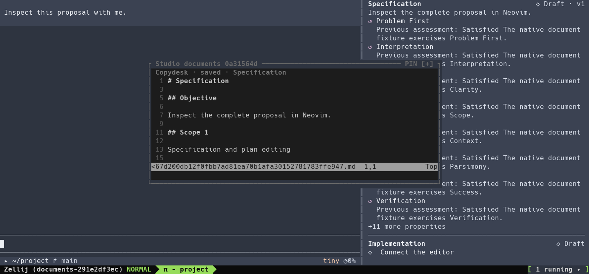
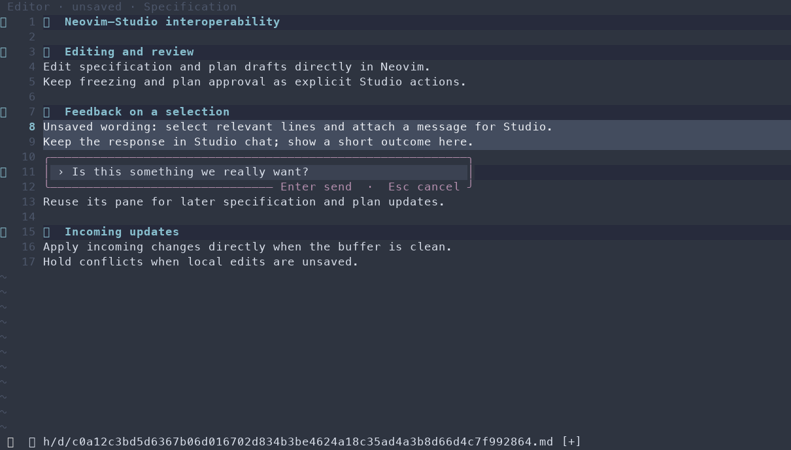
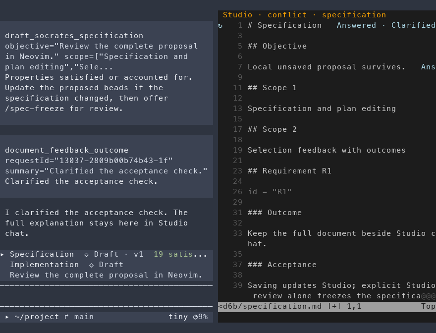

# Specifications and plans in Neovim

Copydesk lets Studio open its complete specification and plan beside the conversation in a companion Neovim pane. Edit the documents with normal Neovim controls, save with `:write`, or send a selection and a short message back to the Studio conversation. Chat, Socrates questions, specification freezing, and plan approval stay in Studio.

## Enable the companion

Enable both integrations in Studio's configuration, then start or reload Studio inside Zellij:

```toml
[integrations.zellij]
enabled = true

[integrations.neovim]
enabled = true
executable = "nvim"
```

The first available draft opens a centered floating pane without taking keyboard focus or resizing Studio. Studio reuses that pane for subsequent updates. `/documents` opens it explicitly or reopens it after you close it. Your ordinary Neovim initialization and plugins load before Studio attaches its document adapter. Other Studio features remain usable with this integration disabled or unavailable.

The specification and plan are separate Markdown buffers. `:CopydeskDocuments` selects one. Each belongs to its original document and conversation; selecting another discovery in Studio does not reassign an existing buffer or comment. Incoming documents and updates preserve your current editor window.



## Edit and save

Use `:write` to submit the current document to Studio. Prose is ordinary Markdown, with small TOML blocks for structured fields such as task dependencies and verification arguments. Keep the generated section boundaries intact. Invalid content remains in the buffer with an error explaining why Studio could not accept it. Identity, approval, and execution metadata are managed by Studio.

Discovery work breakdowns remain editable while the specification is being discussed. The documents retain the specification's PR-delivery decision and the plan's merge policy. Editor saves use the same requirement and delivery checks as Studio's drafting tools. Saving specification edits invalidates the earlier assessment. Saving a changed plan retains the property evidence and puts it up for review. Ask Studio to reassess before freezing or approving.

Studio retains the authoritative planning state. Both editor saves and agent revisions check the version they were based on. A confirmed save clears the modified flag only if you have not typed more text while it was being accepted. A lost acknowledgment is reconciled using the same save operation before a new one is submitted. Studio retains the accepted document and an operation-specific witness in the same transaction, so identical text from another writer cannot be mistaken for a successful save.

Clean buffers update directly when Studio changes a document. A buffer with unsaved edits keeps its text and holds the incoming revision for comparison. `:CopydeskCompare` opens the local and incoming versions. Merge the desired text into the local document, then use `:CopydeskResolve` to adopt the incoming version as the base for your next explicit save. `:CopydeskReload!` deliberately discards local edits and loads the incoming version.

Frozen specifications and approved plans retain Studio's existing protection. Use the indicated Studio reopen command before revising protected content. Editing or saving never freezes a specification, approves a plan, or starts execution. Changes to settled decisions must retain their history through the existing successor-decision rules.

Saved specifications without current decision metadata or complete assessments open read-only. Ask Studio to redraft them with that information before editing; opening a document never silently migrates it.

## Send feedback on a selection

Select lines and run `:CopydeskComment`, or use the buffer-local `<localleader>sc` mapping. Without a selection, the command attaches the current line. A purple-bordered input opens next to the target lines. Type your question or direction, then press Enter to send or Escape to cancel. Studio receives the exact selected text, including unsaved edits, together with the document, range, and revision. Sending feedback does not save the document or answer a pending Socrates question.



Studio processes comments when its conversation is available. If you switch to another discovery before a comment is handled, the request remains associated with its original document and is parked rather than sent to the new selection. The full response appears in Studio chat. Neovim shows a compact pending or response marker, a short outcome, and navigation to the resulting changes. A response can explain a decision without changing the document.

Use `:CopydeskResponses` or `<localleader>sr` to inspect outcomes and `:CopydeskChanges` or `<localleader>sd` to navigate their effects. Request receipt, an actual response, and application of a document update are separate states. A conflicting incoming change remains visibly unapplied even after Studio has answered the comment.

Quitting Studio leaves the Neovim buffers available. If Studio is the last tiled pane in its Zellij tab, Studio tiles a verified document editor on quit to keep the tab open. This also preserves a document editor that disconnected during a Studio reload. A disconnected editor cannot silently bind to a new Studio process or another conversation. Preserve any local edits while reconnecting or reopening the companion through Studio. The integration retains feedback receipts and confirmed outcomes in Studio's private state for subsequent inspection.




These images reconstruct terminal output from the isolated native acceptance run. They use Studio's default theme and a minimal Neovim configuration.

## Upgrade from Editor Interop

Studio still uses `integrations.neovim` and `integrations.zellij` to configure Copydesk. Replace any custom mappings that use `:Editor…` with the corresponding `:Copydesk…` command.

The migration uses an exact Git commit rather than a GitHub archive checksum so the repository rename can follow the Studio upgrade.

## Development acceptance

Studio consumes a pinned [Copydesk](https://github.com/lanej/copydesk) package. The independent repository owns the protocol, local transport, Neovim runtime and host-independent editor acceptance. Studio owns document codecs, revision and approval policy, atomic persistence, conversation attribution and Zellij launching. Planning controls stay active when the editor integration is disabled.

`bun test tests/documents-model.test.ts tests/documents-host.test.ts tests/documents-admission.test.ts` exercises Studio document round trips, guarded writes and request attribution. `bun run test:documents-native` runs the installed package with real Studio, Zellij and Neovim using a deterministic local provider and isolated state. The macOS/Linux CI job uses Neovim 0.12.6 and builds the custom Zellij revision pinned in `zellij-revision`; upstream Zellij does not supply this control protocol. The provider fixture establishes behavior and attribution, not live-model response quality.
